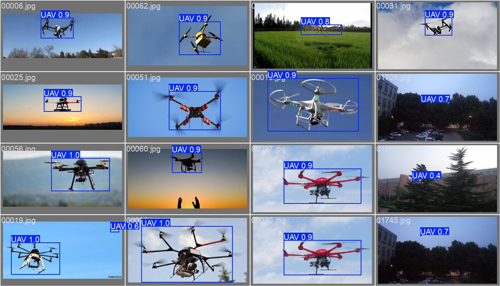
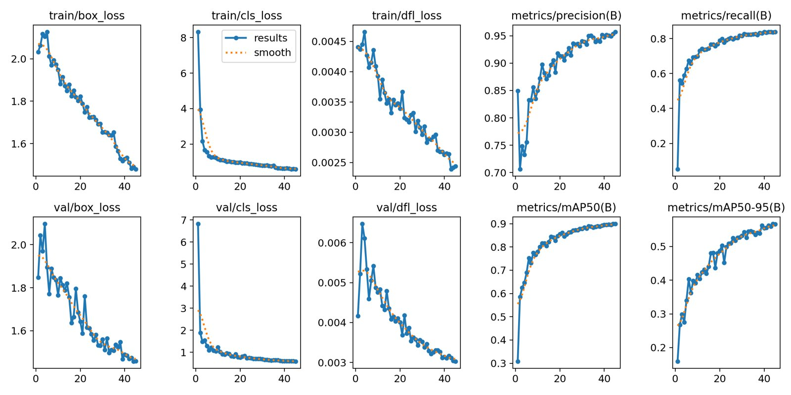
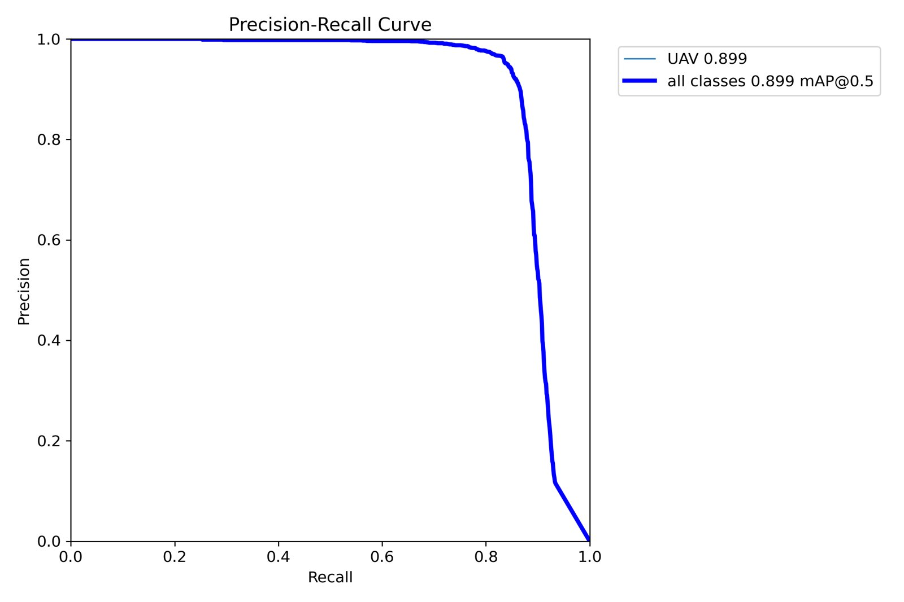
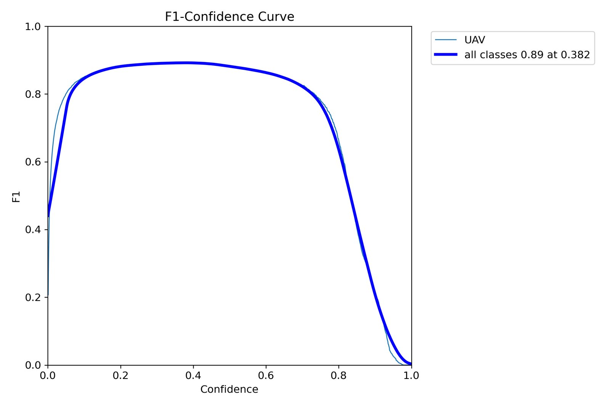
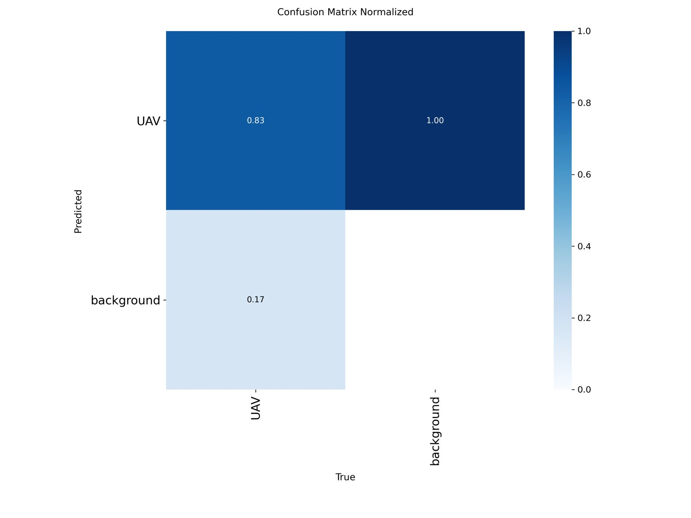

# YOLO26 Drone Detection & Multi-Modal Trajectory Prediction

Real-time drone (UAV) detection with **YOLO26n**, combined with a trajectory prediction model that estimates **multiple possible future flight paths** of a detected drone. Built for surveillance and counter-UAS use, and deployed and tested on an **NVIDIA Jetson Nano**.

<p align="center">
  
</p>

---

## How it works

```
Video feed ──► Frames ──► YOLO26n detector ──► Drone bounding box
                                                     │
                                          Centre point per frame
                                                     │
                                      Historical trajectory sequence
                                                     │
                                 LSTM-CVAE trajectory prediction model
                                                     │
                                Several possible future flight paths
```

1. **Detection.** Each frame goes through YOLO26n, a lightweight, NMS-free detector suited to small targets and real-time inference. The model was trained on the DUT Anti-UAV dataset.
2. **Tracking.** The centre of each detected drone is recorded across frames to build its recent flight history.
3. **Prediction.** An LSTM-based Conditional Variational Autoencoder (CVAE) takes that history and samples several plausible future paths, so the system can anticipate where the drone may go next rather than giving one fixed guess.

---

## Test run results (YOLO26n)

These figures come from a **test run** of the detector, included here to show the training pipeline and model behaviour.

| Metric | Value |
|---|---|
| Precision | 0.953 |
| Recall | 0.836 |
| mAP@50 | 0.900 |
| mAP@50-95 | 0.567 |

**Configuration:** YOLO26n (Ultralytics), 640×640 input, 45 epochs, batch size 64, 2 GPUs.

> **Note:** The experiments reported in the accompanying research paper (currently under peer review) were run separately, with a different configuration, and are kept private for now. I'm happy to share them on request.

<p align="center">
  
</p>

<p align="center">
  
  
</p>

<p align="center">
  
</p>

---

## Edge deployment

The trained detector was deployed and tested on an **NVIDIA Jetson Nano**, to check that drone detection runs in real time on low-power hardware that could sit next to a camera in the field, rather than needing a full GPU workstation.

---

## Repository contents

| Path | What it contains |
|---|---|
| `Drone-Trajectory-Dataset/generate_trajectories.py` | Generates synthetic drone flight trajectories (hovering, straight-line flight and other motion patterns) with added noise |
| `Drone-Trajectory-Dataset/create_windows.py` | Slices trajectories into past/future windows for training the prediction model |
| `Drone-Trajectory-Dataset/synthetic_drone_trajectories.csv` | The generated trajectories |
| `Drone-Trajectory-Dataset/X.npy`, `Y.npy` | Input (past) and target (future) windows ready for training |
| `results/` | Plots and sample predictions from the YOLO26n test run |

The detection training and LSTM-CVAE trajectory prediction code will be released after the paper's peer review.

---

## Datasets

- **DUT Anti-UAV** for drone detection (Pascal VOC annotations converted to YOLO format)
- **Stanford Drone Dataset** for trajectory prediction
- Synthetic trajectories generated with the scripts in this repo

---

## Author

**Lalith Swaroop Pochiraju**, B.Tech ECE, Lendi Institute of Engineering and Technology
[GitHub](https://github.com/Lalith-pochiraju) · [LinkedIn](https://www.linkedin.com/in/pochiraju-lalith-swaroop) · [Portfolio](https://lalith-portfolio1.vercel.app/)
